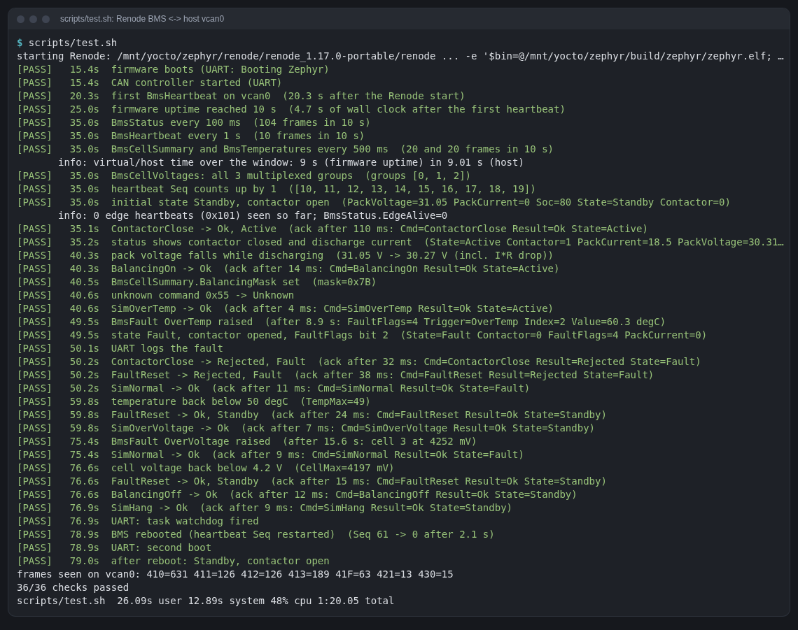

# zephyr-bms-can

A fake battery management system (BMS): **Zephyr RTOS firmware in C** for an
STM32H743 (NUCLEO-H743ZI board), running in the **Renode** simulator, with
its CAN controller bridged to the host's SocketCAN interface `vcan0`. On that
bus it talks to an embedded Linux edge controller running in QEMU, and any
SocketCAN tool on the host can watch and decode the traffic.

This is a **learning and portfolio project**: the battery, the MCU and the
bus are all simulated, there is no hardware, and the pack model is a toy.
What is real is the firmware (the same ELF would run on a NUCLEO-H743ZI),
the CAN protocol described in a DBC file, and the automated end-to-end tests.
[docs/learning-guide.md](docs/learning-guide.md) explains every piece and
every command.

Pairs with [edge-linux-can](https://github.com/dzulfikar08/edge-linux-can):
the Yocto Linux edge image (Rust CAN service, RAUC A/B updates) that sits on
the other end of the bus.



```
 Renode (STM32H743, Zephyr 3.7)            host                     QEMU (aarch64, Yocto Linux)
 ┌────────────────────────────┐                                    ┌──────────────────────────┐
 │ bms thread ◄─ k_msgq ◄─ k_timer 100 ms                          │ can-demo@can0  (Rust)    │
 │     │          ▲   └──── CAN RX filters (0x420, 0x101)          │   heartbeat 0x101 / 1 s  │
 │     ▼          │                                                │ candump / cansend        │
 │ tx k_msgq ─► can_tx thread ─► FDCAN1 (Renode MCAN model)        │ can0 = kvaser_pci        │
 │ task watchdog ─► IWDG                                           └────────────▲─────────────┘
 └──────────────────────────────────┬─┘                                         │
                         CANHub ── SocketCAN bridge ──►  vcan0  ◄── can-host-socketcan
                                                          ▲  ▲
                              tools/can-watch.py (DBC decode)  tools/bms_test.py, bms-cmd.py
```

## What it does

- Simulates an 8-cell, 5 Ah pack: cell voltages, current, SOC, four
  temperature sensors, passive balancing.
- A state machine: `Standby` (contactor open) → `Active` (closed, 18.5 A
  discharge) → `Fault` (latched, contactor forced open until a reset is
  accepted, with hysteresis).
- Sends on CAN (11-bit ids, layouts in [dbc/zephyr-bms.dbc](dbc/zephyr-bms.dbc)):

  | Id | Message | Period |
  |---|---|---|
  | `0x410` | BmsStatus: pack V, I, SOC, state, contactor, balancing, fault flags, EdgeAlive | 100 ms |
  | `0x411` | BmsCellSummary: min/max cell, balancing mask | 500 ms |
  | `0x412` | BmsTemperatures: 4 sensors, max | 500 ms |
  | `0x413` | BmsCellVoltages: all 8 cells, multiplexed 3 per frame | 1 s |
  | `0x41F` | BmsHeartbeat: sequence, uptime | 1 s |
  | `0x421` | BmsCommandAck: command, token, result, state | on command |
  | `0x430` | BmsFault: flags, trigger, index, value | on fault + 1 s while active |

- Receives `0x420` BmsCommand from the edge controller: contactor
  close/open, balancing on/off, fault reset, and simulation commands that
  inject an over-temperature or over-voltage, or hang the BMS thread (to
  show the watchdog reset).
- Listens for the edge controller's heartbeat `0x101` and reports
  `EdgeAlive` in BmsStatus.
- Ids are chosen not to clash with edge-linux-can's `0x100`, `0x101`, `0x321`.

Zephyr features used: two threads, two message queues, a kernel timer, the
CAN API with hardware RX filters, logging, the task watchdog with the STM32
IWDG as hardware fallback, `sys_reboot`, a devicetree overlay, Kconfig.

## Layout

```
app/                      the Zephyr application
  CMakeLists.txt, prj.conf
  boards/nucleo_h743zi.overlay   devicetree overlay: CAN bitrate 500 kbit/s
  src/main.c              Zephyr glue: threads, queues, timer, CAN, watchdog
  src/pack.c, pack.h      pack model + BMS state machine (plain C, no Zephyr)
dbc/zephyr-bms.dbc        the BMS frames
dbc/can-demo.dbc          copy of edge-linux-can's DBC (edge frames)
renode/bms.resc           Renode script: machine, firmware, CAN hub, SocketCAN bridge
renode/nucleo_h743zi_bms.repl   Renode platform: NUCLEO-H753ZI + IWDG clock fix
scripts/env.sh            paths and versions (source it)
scripts/setup.sh          one-time setup on the build disk, restartable
scripts/build.sh          west build
scripts/run-renode.sh     run the BMS until Ctrl-C (headless or GUI)
scripts/test.sh           end-to-end test (36 checks)
scripts/term2png.py       terminal text → PNG for the docs
tools/bms_test.py         the test: Renode + vcan0 + DBC decoding
tools/edge_demo.py        BMS in Renode <-> edge-linux-can image in QEMU (13 checks)
tools/bms-cmd.py          send one command, print the ack
tools/minidbc.py          small DBC decoder for the Python tools (stdlib only)
tools/can-watch.py        live SocketCAN monitor with DBC decoding
tools/renode_monitor.py   run Renode Monitor commands over telnet
docs/                     learning guide, logs of the runs, images
```

## Quick start

Requirements: Linux with SocketCAN, `uv`, `cmake`, `ninja`, `git`, `curl`,
Python 3, and a `vcan0` (needs root once per boot):

```sh
sudo modprobe vcan && sudo ip link add dev vcan0 type vcan && sudo ip link set up vcan0
```

Everything heavy goes under `$ZBMS_STORAGE` (default
`/mnt/yocto/zephyr`, see [scripts/env.sh](scripts/env.sh)):

```sh
scripts/setup.sh          # ~3 min: west + Zephyr v3.7.2 (2 modules) + SDK 0.16.8 arm + Renode 1.17.0
scripts/build.sh          # ~45 s from scratch: west build -b nucleo_h743zi
scripts/test.sh           # ~80 s: Renode headless, 36 checks over vcan0
scripts/run-renode.sh     # run it; Ctrl-C to stop. GUI=1 for Renode's windows
```

While it runs:

```sh
tools/bms-cmd.py ContactorClose        # ack 0x421: Result=Ok State=Active
tools/bms-cmd.py SimOverTemp           # ~7 s later: BmsFault, State=Fault
tail -f /tmp/zephyr-bms-uart.log       # the firmware's log
telnet localhost 34555                 # Renode Monitor
tools/can-watch.py vcan0 dbc/zephyr-bms.dbc dbc/can-demo.dbc --secs 30   # decoded live traffic
```

With the [edge-linux-can](https://github.com/dzulfikar08/edge-linux-can) image (a copy of its `deploy/images/qemuarm64`
files in `$ZBMS_STORAGE/edge-image`, see the guide):

```sh
. scripts/env.sh && tools/edge_demo.py
```

Any GUI CAN tool that reads SocketCAN and DBC files works too: connect to
`vcan0` and load `dbc/zephyr-bms.dbc` (and `dbc/can-demo.dbc` for the edge
frames).

## What was verified (2026-11-11, all in Renode/QEMU on one laptop)

| Check | Result |
|---|---|
| `west build` for `nucleo_h743zi`, Zephyr 3.7.2, SDK 0.16.8 (GCC 12.2) | 0 warnings; 49.9 KB flash, 12.5 KB RAM |
| Firmware boots in Renode 1.17.0 (NUCLEO-H753ZI platform) | yes; first frame on vcan0 11–20 s after Renode starts |
| Frames on host `vcan0` via Renode's SocketCAN bridge | 0x410 100/10 s, 0x41F 10/10 s, 0x411/0x412 20/10 s, 0x413 all 3 groups |
| Command → ack → state change (contactor, balancing, unknown cmd) | yes, acks in 3–150 ms of host time |
| Over-temperature and over-voltage faults: fault frame, contactor opens, closing rejected, reset rejected while hot, accepted after cooling | yes |
| Task watchdog: a stalled thread is detected after 1.0 s, MCU resets (SYSRESETREQ), firmware boots again | yes, heartbeat back ~2 s after the stall |
| [scripts/test.sh](scripts/test.sh) | **36/36** ([log](docs/logs/test-run.txt), [image](docs/images/test-run.png)) |
| Edge image (edge-linux-can, QEMU 7.0 kvaser_pci) on the same vcan0: BMS frames on guest `can0`, guest `cansend` closes the contactor, BMS sees the guest heartbeat (EdgeAlive=1) | **13/13** ([log](docs/logs/edge-demo.txt), [image](docs/images/edge-demo.png)) |
| A full DBC decoder (the CAN library of my own SocketCAN-based CAN analyzer tool, not in this repo) decodes both devices with the two DBC files | yes |

## Not done / not verified

- **No hardware.** The CAN controller is Renode's MCAN model and the bus is a
  host vcan: no bit timing, ACKs, error frames or bus-off. Renode logs the
  bit-timing register write as unhandled. The 500 kbit/s overlay only shows
  up in the generated devicetree; it was never on a wire.
- The CAN state-change callback (bus-off, error-passive) is wired up but
  never fired: the emulated bus has no errors.
- The IWDG hardware fallback (task watchdog itself stuck) was not provoked;
  only a task-watchdog channel timeout, which reboots by `sys_reboot`.
- No unit tests for `pack.c` (it has no Zephyr dependencies, so ztest on
  `native_sim` or a host compiler would be the next step).
- Rust on Zephyr was not evaluated; the firmware is C.
- The edge image used is a copy of the edge-linux-can build of 2026-11-10
  (`edge-image-qemuarm64.rootfs-20261110224634`), booted with the Zephyr
  SDK's QEMU 7.0 instead of the Yocto-built QEMU 10.2 (to stay out of a
  running kas/bitbake build). Boot to login took 92–109 s under
  load.

## Versions

| Component | Version |
|---|---|
| Zephyr | **v3.7.2** (3.7 is the current LTS; latest stable is 4.5.0, next LTS planned as 4.6) |
| Zephyr SDK | 0.16.8 (arm-zephyr-eabi GCC 12.2.0 + host tools: dtc 1.6.0) |
| west | 1.5.0, Python 3.12 venv (uv) |
| Modules | cmsis `4b96cbb`, hal_stm32 `0657d9f` (only these two) |
| Renode | 1.17.0 portable (bundled .NET) |
| QEMU for the edge image | 7.0.0 from the Zephyr SDK host tools |

## Disk and time

On the build disk (`$ZBMS_STORAGE`): **3.1 GB** in total:
Zephyr SDK 1.3 GB, west workspace 1.1 GB (hal_stm32 640 MB, zephyr 402 MB,
both shallow clones), downloads 196 MB, Renode 184 MB, edge image copy
243 MB, firmware build 19 MB. The repo itself is
under 2 MB. Outside it, tiny: `~/.cmake/packages/Zephyr-sdk` (CMake package
registry entry), `~/.cache/zephyr` (toolchain capability cache),
`~/.config/renode/history` (Monitor history).

Setup 3 min (network bound), pristine build 45 s, test 75–80 s, edge demo 3–3.5 min
15 s (of which QEMU boot ~100 s). Details in the guide.

## License

MIT, see [LICENSE](LICENSE): the firmware, Renode scripts, Python tools,
DBC files and docs in this repository.

Third-party code is **not vendored**: Zephyr, its modules (cmsis,
hal_stm32), the Zephyr SDK, west and Renode are downloaded by
`scripts/setup.sh` at the versions below and stay under their own licences
(Apache-2.0 for Zephyr, BSD-3-Clause/Apache-2.0 for the ST and Arm HALs, MIT
for Renode). `renode/nucleo_h743zi_bms.repl` loads Renode's own `nucleo_h753zi.repl`
platform by path and only overrides the watchdog clock.
