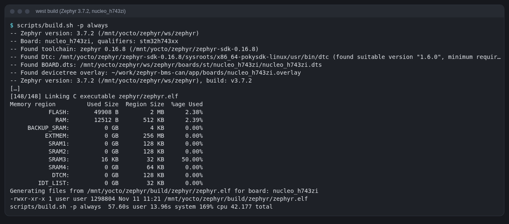
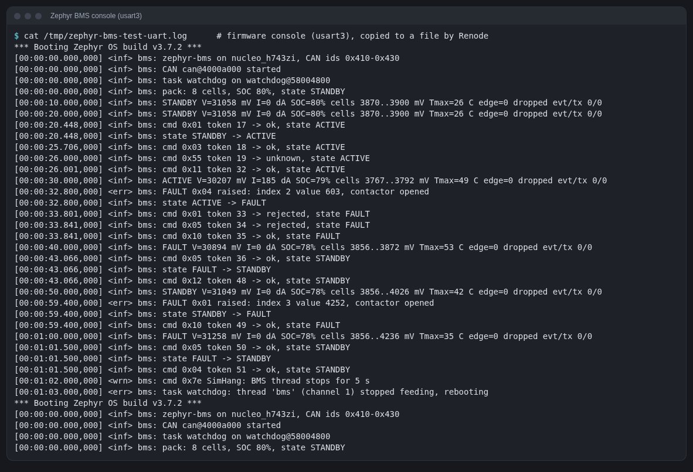
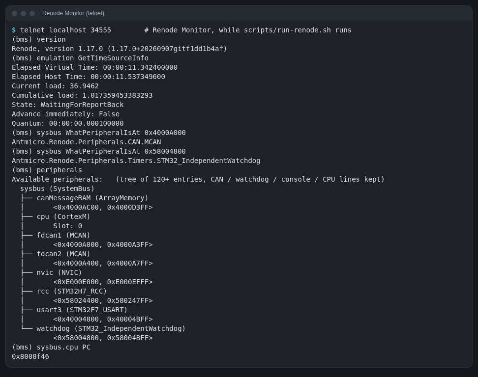
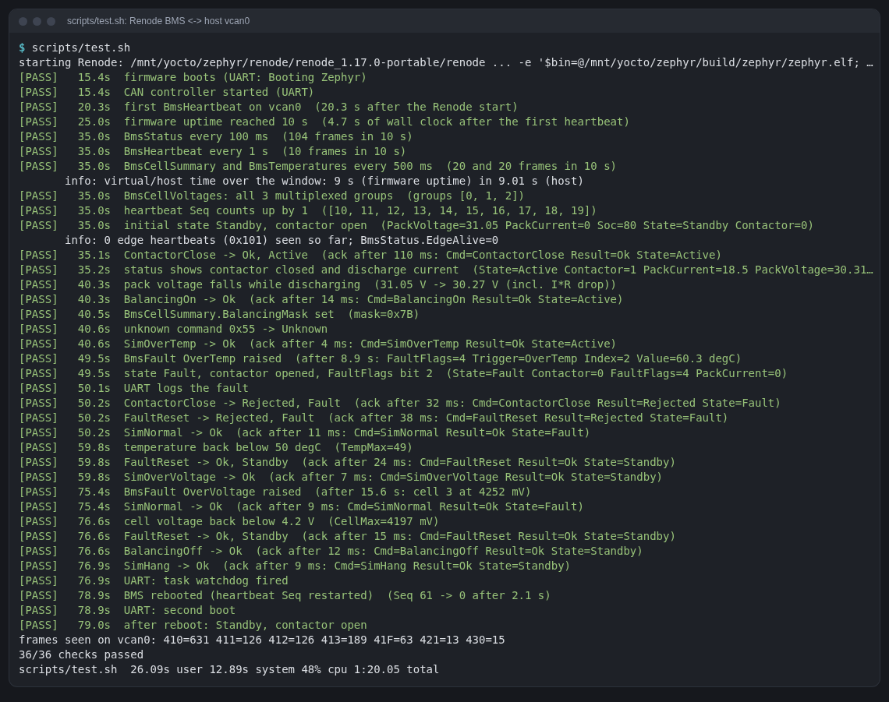
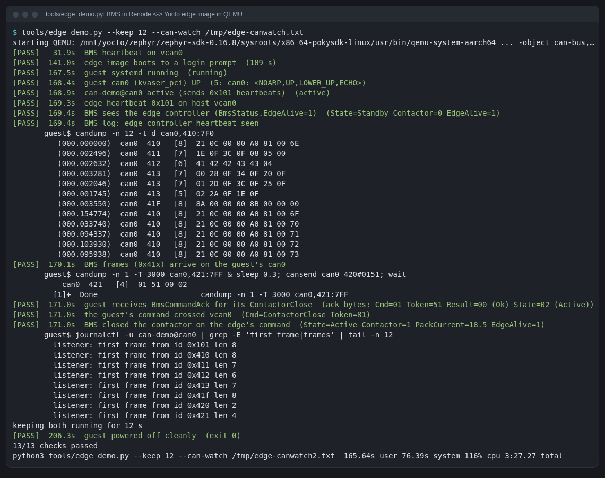

# Learning guide: a CAN BMS on Zephyr, simulated in Renode

The companion project, [edge-linux-can](https://github.com/dzulfikar08/edge-linux-can),
covers embedded Linux. This guide covers the other end of the bus: a microcontroller running an
RTOS. Every concept appears where this project needed it, with the command
that was run and what came out. Everything here ran on 2026-11-11.

Contents

1. [The big picture](#1-the-big-picture)
2. [RTOS vs embedded Linux](#2-rtos-vs-embedded-linux)
3. [Choosing the board: what Renode can simulate with CAN](#3-choosing-the-board)
4. [Setting up: west, the SDK, Renode](#4-setting-up)
5. [Zephyr concepts, as used in the firmware](#5-zephyr-concepts-as-used)
6. [The CAN design and the DBC](#6-the-can-design-and-the-dbc)
7. [Renode concepts](#7-renode-concepts)
8. [Testing it end to end](#8-testing-it-end-to-end)
9. [The edge controller: edge-linux-can in QEMU on the same bus](#9-the-edge-controller-on-the-same-bus)
10. [Problems hit and how they were fixed](#10-problems-hit-and-fixes)
11. [Timings and disk use](#11-timings-and-disk-use)
12. [Where to go next](#12-where-to-go-next)

---

## 1. The big picture

Three "devices" share one CAN bus, the host's virtual CAN interface `vcan0`:

| Device | Runs | Simulated by | Reaches vcan0 through |
|---|---|---|---|
| BMS (this repo) | Zephyr 3.7, C, on an STM32H743 (Cortex-M7, 480 MHz, 2 MB flash, 1 MB RAM) | Renode | Renode `CANHub` + `SocketCANBridge` |
| Edge controller (edge-linux-can) | Yocto Linux, Rust `can-demo` service | QEMU (`qemu-system-aarch64`) | QEMU `can-bus` + `can-host-socketcan`, Kvaser PCI card in the guest |
| Your tools | `can-watch.py`, `bms_test.py`, `bms-cmd.py`, any SocketCAN tool | the host itself | a `CAN_RAW` socket on vcan0 |

A frame the BMS sends goes: firmware calls `can_send()` → Zephyr's
`can_stm32h7_fdcan` driver writes the frame into the FDCAN message RAM and
sets a TX request bit → Renode's `MCAN` model sees the register write and
hands the frame to the `CANHub` → the hub forwards it to every other node,
including the SocketCAN bridge → the bridge writes it to a `CAN_RAW` socket
on host `vcan0` → every socket on vcan0 (can-watch.py, QEMU's bridge, the test)
gets a copy → QEMU injects it into the emulated Kvaser card → the Linux
`kvaser_pci` driver delivers it to `can0` in the guest.

The firmware has no idea it is simulated: it is the same ELF you would flash
on a real NUCLEO-H743ZI.

## 2. RTOS vs embedded Linux

edge-linux-can built a whole Linux distribution; this repo builds one
program. The differences you will feel:

| | Embedded Linux (edge-linux-can) | RTOS (Zephyr, this repo) |
|---|---|---|
| Hardware | Application processor with an MMU (Cortex-A57 here), hundreds of MB of RAM | Microcontroller without MMU (Cortex-M7), RAM in KB-MB |
| What you build | Kernel + rootfs + packages: **221 MiB** image, 110 packages | One linked binary: **49.9 KB** flash, **12.5 KB** RAM |
| Build | Yocto: 5.5 h first build, 32 GB | west/CMake: **45 s**, 19 MB build dir |
| Boot to running | 24–32 s (TCG) to a login prompt | **< 1 ms** of emulated time to `main()` |
| Isolation | Processes, virtual memory, users, capabilities | One address space. Threads can corrupt each other; the MPU can at least guard stacks (`CONFIG_HW_STACK_PROTECTION`) |
| Scheduling | CFS, "fair"; real time needs PREEMPT_RT and care | Fixed-priority preemptive: the highest-priority ready thread always runs. Latency is bounded and small |
| Drivers | Kernel drivers, used through syscalls and sockets (SocketCAN) | Drivers are libraries linked into your program; you call `can_send()` directly |
| Configuration | `local.conf`, recipes, systemd units | Devicetree (hardware) + Kconfig (software), resolved at **compile** time |
| Updates | RAUC, A/B partitions | MCUboot + image slots (not done here) |
| Logging | journald | `LOG_*` macros into a ring buffer, printed on a UART |
| Watchdog | systemd feeds `/dev/watchdog` | Your threads feed the task watchdog, which feeds the hardware one |

Why a real BMS is a microcontroller: the safety reaction (open the contactor
on over-temperature) must happen within milliseconds, every time, and boot
must be instant after a brown-out. Why the edge box is Linux: networking,
storage, updates, many protocols, and a developer experience you already
know. The two talk over CAN, which is exactly this setup.

Zephyr in particular: an RTOS from the Linux Foundation with a
Linux-inspired toolbox (Kconfig, devicetree, CMake) and a large driver
model, so the same `can_send()` works on STM32, NXP, Nordic, ESP32...

## 3. Choosing the board

Requirement: a board that **Zephyr supports** and whose CAN controller
**Renode models well enough for Zephyr's driver**. Renode 1.17.0's
platform files (`platforms/cpus/*.repl`) list these CAN models:

```sh
cd $RENODE_DIR && grep -rhoE 'CAN\.[A-Za-z_]+' platforms | sort | uniq -c
```

| Renode model | Used in | Zephyr driver it would need |
|---|---|---|
| `CAN.MCAN` (Bosch M_CAN) | `stm32h7.repl` (fdcan1, fdcan2) | `can_stm32h7_fdcan` (built on `can_mcan`) |
| `CAN.STMCAN` (bxCAN) | stm32f0/f4/f746/f777, and stm32g0 (where the real chip has FDCAN) | `can_stm32_bxcan` |
| `CAN.STM32_FDCAN` | stm32l552 | `can_stm32_fdcan` |
| `CAN.NXP_FlexCAN` | S32K388, i.MX8MP | `can_mcux_flexcan` |
| `CAN.MPFS_CAN`, `LPC_CAN`, `UT32_CAN` | PolarFire SoC, LPC2294, UT32M0R500 | not Zephyr targets of interest |

The decisive evidence was in Renode's own test suite and demos:

- `tests/peripherals/MCAN.robot` boots **Zephyr's own CAN test suites**
  (`tests/drivers/can/api`, `can/timing`, ISO-TP, socket CAN) built for
  `nucleo_h743zi`, on `stm32h753.repl`. So Antmicro (Renode's authors)
  continuously test exactly this driver/model pair.
- `scripts/complex/socketcan_bridge/nucleo_h743zi-socketcanbridge.resc`
  is a ready demo of the SocketCAN bridge on this board.
- `stm32h7.repl` also models the IWDG (`STM32_IndependentWatchdog`), so the
  watchdog part of the task works too.

Hence: **Zephyr board `nucleo_h743zi`**, **Renode platform
`nucleo_h753zi.repl`** (the H753 is an H743 plus a crypto block; Renode has
no separate H743 board file). The H743 also has an FPU, handy for the float
pack model. The other candidates were not tried; bxCAN on an STM32F4 would
probably work too, but nothing in Renode's tests shows Zephyr on it.

(The bus is classic CAN here, although FDCAN can do CAN FD: the edge
controller's can-demo handles classic frames only.)

## 4. Setting up

All heavy files live on the build disk, under `$ZBMS_STORAGE`
(`/mnt/yocto/zephyr`). `scripts/env.sh` defines every path and
version; source it in each shell: `. scripts/env.sh`.

`scripts/setup.sh` does four steps, each skipped if already done, so after an
interruption (laptop sleep, network) you just run it again.

### 4.1 A Python venv with west

```sh
uv venv --python 3.12 $ZBMS_VENV
uv pip install --python $ZBMS_VENV/bin/python west
```

**west** is Zephyr's meta-tool: it manages the workspace (like `repo` or
kas's repo handling), and wraps CMake for building (`west build`) and
flashing (`west flash`, not used: nothing to flash). The host has Python
3.14; Zephyr 3.7's scripts were written for 3.10–3.12, so the venv uses 3.12
(provided by uv). This was a precaution, not a reaction to an error.

### 4.2 The west workspace: Zephyr + only two modules

```sh
west init -m https://github.com/zephyrproject-rtos/zephyr --mr v3.7.2 --clone-opt=--depth=1 $ZBMS_WS
cd $ZBMS_WS
west config manifest.project-filter -- '-.*,+cmsis,+hal_stm32'
west update --narrow --fetch-opt=--depth=1
uv pip install -r zephyr/scripts/requirements-base.txt
```

A **workspace** is a directory with `.west/` (config), the **manifest
repository** (`zephyr/`, whose `west.yml` lists every other repository at a
pinned commit) and the **modules** (`modules/hal/...`). Zephyr's manifest
lists ~50 modules: every vendor's HAL, mbedTLS, LVGL, ... A full
`west update` is several GB. The **project filter** keeps only what an STM32
build needs: `cmsis` (Arm's core headers) and `hal_stm32` (ST's register
definitions and LL drivers that Zephyr's STM32 drivers call). Shallow clones
(`--depth=1`) skip history. Result: 1.1 GB, of which hal_stm32 is 640 MB.

`v3.7.2` because **3.7 is the current LTS** (supported until 2029; regular
releases get about a year). The latest stable is 4.5.0 and the next LTS is
planned as 4.6 (April 2027). For a product you would pick the LTS; for
learning both work, and the LTS's docs and samples match this code.

Compare to Yocto: west manifest ≈ the kas file's `repos:` with pinned
commits; a module ≈ a layer that brings code (and Kconfig/CMake glue).

### 4.3 The Zephyr SDK (only the arm toolchain)

```sh
curl -LO .../zephyr-sdk-0.16.8_linux-x86_64_minimal.tar.xz     # 41 MB: cmake package, setup script
curl -LO .../toolchain_linux-x86_64_arm-zephyr-eabi.tar.xz     # 93 MB: GCC 12.2 for Cortex-M/R/A32
tar -xJf ...                                                   # → zephyr-sdk-0.16.8/arm-zephyr-eabi/
./zephyr-sdk-x86_64-hosttools-standalone-0.9.sh -y -d .        # host tools: dtc, openocd, qemu, ...
cmake -P cmake/zephyr_sdk_export.cmake                         # register in ~/.cmake/packages
```

The full SDK has toolchains for ~10 architectures (several GB); the
"minimal" bundle plus one toolchain is 1.3 GB unpacked. SDK 0.16.8 is the
one Zephyr 3.7 documents (SDK 1.0 exists, made for 4.x).

The SDK's own `setup.sh` would do the last two steps but **refuses to run
without `wget`**, which is not installed (and installing it needs root), even
though those steps download nothing. So `scripts/setup.sh` runs them
directly. The `cmake -P` step writes one small file in
`~/.cmake/packages/Zephyr-sdk/` so that Zephyr's CMake finds the SDK.

**dtc** (the devicetree compiler) is needed by Zephyr's build; Arch doesn't
have it installed, the SDK host tools do, so `env.sh` puts
`.../sysroots/x86_64-pokysdk-linux/usr/bin` on `PATH`.

### 4.4 Renode

```sh
curl -LO https://github.com/renode/renode/releases/download/v1.17.0/renode-1.17.0.linux-portable.tar.gz
tar -xzf renode-1.17.0.linux-portable.tar.gz        # 184 MB, includes its own .NET runtime
```

The "portable" build needs nothing installed (no mono/dotnet, no root).

## 5. Zephyr concepts as used

### 5.1 The application: three files make a Zephyr app

```
app/CMakeLists.txt     find_package(Zephyr) + your sources
app/prj.conf           Kconfig: which subsystems you want
app/src/*.c            your code
```

```cmake
find_package(Zephyr REQUIRED HINTS $ENV{ZEPHYR_BASE})
project(zephyr_bms LANGUAGES C)
target_sources(app PRIVATE src/main.c src/pack.c)
```

`find_package(Zephyr)` pulls in the whole Zephyr build: the kernel, the
drivers your devicetree and Kconfig enable, the linker script. Your code
goes into the `app` library, linked with everything into `zephyr.elf`.

This app is **out of tree** (outside the west workspace), which is how you
keep your code in your own repo; `ZEPHYR_BASE` tells CMake where Zephyr is.

### 5.2 Building with west

```sh
west build -b nucleo_h743zi -d $ZBMS_BUILD app          # scripts/build.sh
west build -d $ZBMS_BUILD -p always app                 # -p always: pristine (clean) build
west build -d $ZBMS_BUILD -t menuconfig                 # browse/change Kconfig interactively
```

`-b` picks the **board**: `zephyr/boards/st/nucleo_h743zi/` holds its
devicetree (`nucleo_h743zi.dts`), default Kconfig
(`nucleo_h743zi_defconfig`) and flashing settings. What you get:



Generated files worth opening in `$ZBMS_BUILD/zephyr/`:
`zephyr.dts` (the final, merged devicetree), `.config` (the final Kconfig),
`zephyr.map` (where every symbol landed), `zephyr.elf` (what Renode loads).

### 5.3 Devicetree: describing the hardware

The devicetree says what hardware exists and how it is wired: addresses,
interrupts, clocks, pins. Zephyr turns it into C macros at build time (no
parsing at run time, unlike Linux where the kernel reads the DTB at boot).
From the board's `.dts`:

```dts
chosen {
    zephyr,console = &usart3;
    zephyr,canbus = &fdcan1;          /* "the" CAN bus for this board */
};
aliases { watchdog0 = &iwdg; };
&fdcan1 {
    pinctrl-0 = <&fdcan1_rx_pd0 &fdcan1_tx_pd1>;
    clocks = <&rcc STM32_CLOCK_BUS_APB1_2 0x00000100>,
             <&rcc STM32_SRC_PLL2_Q FDCAN_SEL(2)>;
    status = "okay";
};
```

And in `main.c`:

```c
static const struct device *const can_dev = DEVICE_DT_GET(DT_CHOSEN(zephyr_canbus));
static const struct device *const hw_wdt  = DEVICE_DT_GET_OR_NULL(DT_ALIAS(watchdog0));
```

`DEVICE_DT_GET` resolves **at compile time** to the driver instance for
that node. If the node didn't exist or wasn't `okay`, it would not compile.
Port the firmware to another board with a CAN bus and these lines don't
change: only the board's devicetree does.

**Overlays** change a board's devicetree from your app without copying it.
`app/boards/nucleo_h743zi.overlay` (picked up automatically because the
file name matches the board) sets the CAN bitrate to match the edge
controller's 500 kbit/s:

```dts
&fdcan1 {
    bitrate = <500000>;
    sample-point = <875>;
};
```

The build log confirms it: `Found devicetree overlay: .../nucleo_h743zi.overlay`,
and `zephyr.dts` now has `bitrate = < 0x7a120 >`. (In Zephyr 3.7 the
property is `bitrate`; `bus-speed` is the deprecated old name.) In the
emulators bit timing is irrelevant, see section 7.5.

### 5.4 Kconfig: choosing the software

Kconfig (same language as the Linux kernel's) switches subsystems on and
sets options. The board's defconfig + your `prj.conf` + dependencies
resolve into `build/zephyr/.config`. This project's `prj.conf`:

| Option | Why |
|---|---|
| `CONFIG_CAN=y` | the CAN API; the driver (`CAN_STM32H7_FDCAN`, `CAN_MCAN`) is then enabled automatically because the devicetree has an `okay` FDCAN node |
| `CONFIG_LOG=y`, `CONFIG_LOG_MODE_DEFERRED=y` | logging; deferred = messages go to a buffer, a low-priority thread prints them, so `LOG_INF` in a time-critical path costs microseconds, not a UART transmission |
| `CONFIG_WATCHDOG=y`, `CONFIG_TASK_WDT=y`, `CONFIG_TASK_WDT_HW_FALLBACK=y` | the task watchdog backed by the IWDG |
| `CONFIG_TASK_WDT_MIN_TIMEOUT=100`, `CONFIG_TASK_WDT_HW_FALLBACK_DELAY=200` | hardware watchdog window = 300 ms (see 5.9 and 10.2) |
| `CONFIG_REBOOT=y` | `sys_reboot()` |
| `CONFIG_THREAD_NAME=y` | names in logs ("thread 'bms' stopped feeding") |
| `CONFIG_FPU=y` | use the M7's FPU for the float model (otherwise floats are emulated in software, or compile errors with hard-float ABI) |
| `CONFIG_HW_STACK_PROTECTION=y` | an MPU guard region below each thread stack: an overflow faults immediately instead of silently corrupting the neighbour |

Unlike Linux, there are no run-time modules: what isn't selected isn't in
the binary. That is how a full RTOS with CAN, logging and a watchdog fits
in 50 KB.

### 5.5 Threads

```c
K_THREAD_DEFINE(bms_tid,    2048, bms_thread,    NULL, NULL, NULL, 5, 0, SYS_FOREVER_MS);
K_THREAD_DEFINE(can_tx_tid, 1024, can_tx_thread, NULL, NULL, NULL, 4, 0, SYS_FOREVER_MS);
```

Stack size in bytes (fixed, allocated statically: there is no growing
stack), entry function, three arguments, **priority**, options, start delay.
`SYS_FOREVER_MS` = don't start yet; `main()` starts them with
`k_thread_start()` after the CAN controller and watchdog are ready.

Priorities: lower number = more important. Non-negative = preemptible. So
`can_tx` (4) preempts `bms` (5) whenever it has a frame to send, which keeps
the bus fed while the model computes. `main` runs at priority 0 and simply
returns when setup is done (that's allowed in Zephyr; the other threads
keep running). Interrupts (timer, CAN) preempt all threads.

Compare to Linux: these are not processes; they share all memory. A
`std::thread` with a fixed priority and a fixed-size stack is closer.

### 5.6 Message queues: who talks to whom

```c
K_MSGQ_DEFINE(evt_q, sizeof(struct bms_evt), 32, 4);      // 32 events of 4 bytes
K_MSGQ_DEFINE(tx_q,  sizeof(struct can_frame), 32, 4);     // 32 CAN frames
```

A `k_msgq` is a fixed-size ring buffer of fixed-size items; `put` **copies**
the item in, `get` copies it out. The pattern used:

- **Producers in interrupt context** (the timer callback and the CAN RX
  callback) must never block, so they use `k_msgq_put(..., K_NO_WAIT)` and
  count what they drop (`dropped evt/tx` in the 10 s status log line: it
  stayed 0/0).
- **One consumer thread** (`bms`) blocks in `k_msgq_get(..., K_FOREVER)`:
  it sleeps until something happens, uses no CPU otherwise, and all pack
  state is touched by this one thread only, so there are no locks.
- The `bms` thread produces CAN frames into `tx_q`; `can_tx` consumes
  them and calls `can_send()`, which may block on a full TX FIFO. So the
  model never waits on the bus.

This "events in, one owner of the state, frames out" structure is the same
as an actor or a tokio task with mpsc channels.

### 5.7 Timers

```c
K_TIMER_DEFINE(tick_timer, tick_fn, NULL);
k_timer_start(&tick_timer, K_MSEC(100), K_MSEC(100));   // first after 100 ms, then every 100 ms
```

`tick_fn` runs **in interrupt context** (the system timer ISR), so it only
posts an `EVT_TICK` to the queue. Why not `k_sleep(K_MSEC(100))` in a loop?
The loop's own run time adds to each period and the schedule drifts; the
timer's period is exact. All periodic frames derive from the tick count
(status every tick, temperatures every 5th, heartbeat every 10th), so they
stay in phase. On the bus: 100 BmsStatus frames per 10 s, measured.

### 5.8 The CAN API

```c
struct can_filter cmd_filter = {.id = 0x420, .mask = CAN_STD_ID_MASK};
can_add_rx_filter(can_dev, can_rx_cb, NULL, &cmd_filter);   // + one for 0x101
can_set_state_change_callback(can_dev, can_state_cb, NULL);
can_start(can_dev);                                          // leave init mode, join the bus
...
struct can_frame f = {.id = 0x410, .dlc = 8};               // standard 11-bit id, classic CAN
can_send(can_dev, &f, K_MSEC(100), NULL, NULL);              // blocking, 100 ms timeout
```

- **RX filters** are programmed into the controller (the M_CAN's filter
  list), so frames with other ids never cause an interrupt. The callback
  runs in the CAN ISR. `mask = CAN_STD_ID_MASK` (0x7FF) means "all 11 bits
  must match": exactly one id per filter.
- `can_send` with no callback **blocks** until the frame is transmitted or
  the timeout expires. With a callback it returns at once and calls you
  from the ISR when done (useful for higher rates).
- `struct can_frame` is the same idea as Linux's `struct can_frame`: id,
  dlc, flags (`CAN_FRAME_IDE` for 29-bit ids, `CAN_FRAME_FDF` for CAN FD),
  data. Byte order of the payload is your job; the firmware uses
  `sys_put_le16/32` to match the DBC's little-endian (`@1`) signals.
- The state-change callback reports error-active / warning / passive /
  bus-off. On a real bus you would react to bus-off (Zephyr can recover
  automatically). In emulation the state never changes.

### 5.9 Logging

```c
LOG_MODULE_REGISTER(bms, LOG_LEVEL_INF);
LOG_INF("cmd 0x%02x token %u -> %s, state %s", ...);
LOG_ERR("FAULT 0x%02x raised: ...");
```

Each module has its own compile-time level; messages below it are compiled
out. Output on the console UART (usart3), with a timestamp and colour:



In the watchdog callback the code calls `LOG_PANIC()` first: it switches
logging to synchronous mode, otherwise the deferred message would still be
in the buffer when the chip resets. In the capture you can see the line
just before the second `*** Booting Zephyr`.

### 5.10 The task watchdog

A hardware watchdog (the STM32 **IWDG**) resets the chip unless it is "fed"
in time. It has one timer, but this firmware has two threads that must both
stay alive. The **task watchdog** multiplexes: each thread gets a channel
with its own period, and the task watchdog feeds the hardware one only
while every channel is fed.

```c
task_wdt_init(hw_wdt);                                      // in main(), IWDG as fallback
int wdt = task_wdt_add(1000, wdt_expired, k_current_get()); // in the thread: 1 s channel
task_wdt_feed(wdt);                                         // every loop iteration
```

- `bms` feeds after each event (every 100 ms at least), timeout 1 s.
- `can_tx` feeds after each frame sent, timeout 2 s.
- If a channel expires, `wdt_expired()` runs: it logs which thread and calls
  `sys_reboot(SYS_REBOOT_COLD)`.
- If the task watchdog itself stopped (interrupts disabled forever, a
  crash), the IWDG would reset the chip after 300 ms
  (`MIN_TIMEOUT + HW_FALLBACK_DELAY`).
- Once started, the IWDG **cannot be stopped** (hardware design), so a
  debugger pausing the CPU would reset it; Zephyr sets "pause when halted by
  debugger" (`WDT_OPT_PAUSE_HALTED_BY_DBG`).

The `SimHang` command (0x7E) makes the `bms` thread sleep 5 s. Result in
the test: `task watchdog: thread 'bms' (channel 1) stopped feeding,
rebooting` 1.0 s after the last feed (firmware timestamps 00:01:02.000 → 00:01:03.000), Renode logs `nvic: Resetting
platform with SYSRESETREQ`, the firmware boots again and the heartbeat
sequence restarts at 0 (2.0–2.1 s after the command, as seen from the host).

### 5.11 The model and the state machine (plain C)

`pack.c` has no Zephyr calls. It is the "business logic": OCV(SOC) line,
I·R drop, first-order temperature lag, balancing bleed, limits with
hysteresis, and the command handling:

| Command (0x420 byte 0) | From state | Result |
|---|---|---|
| ContactorClose (1) | Standby | Ok → Active |
| | Active | Ok (no change) |
| | Fault | **Rejected** |
| ContactorOpen (2) | any | Ok; Active → Standby |
| BalancingOn/Off (3/4) | not Fault / any | Ok (On in Fault: Rejected) |
| FaultReset (5) | Fault | Ok → Standby only if all values are back below the *clear* limits, else **Rejected** |
| SimNormal/SimOverTemp/SimOverVoltage (0x10–0x12) | any | Ok: changes the simulated physics |
| SimHang (0x7E) | any | Ok, then the thread stalls (handled in `main.c`) |
| anything else | | Unknown |

Limits: over-voltage trips above 4250 mV per cell (clears below 4200),
under-voltage below 3000 mV (clears above 3100), over-temperature above
60 °C (clears below 50 °C), over-current above 100 A. Faults latch: the
contactor stays open until a reset is accepted. That is what a real BMS
does: a fault that clears itself would let the contactor chatter.

Keeping this part free of the RTOS means it can be unit tested on the host
(not done yet; section 12).

## 6. The CAN design and the DBC

[`dbc/zephyr-bms.dbc`](../dbc/zephyr-bms.dbc) describes every frame. Ids:

- `0x410`–`0x430`: free on this bus (edge-linux-can uses `0x100`, `0x101`,
  `0x321`).
- On CAN, a **lower id wins arbitration**. The edge heartbeat `0x101` beats
  every BMS frame; the BMS's own status `0x410` beats its fault frame
  `0x430`. In a real design you would give the fault frame and the command a
  low id; here they were grouped for readability, and on an idle emulated
  bus arbitration never happens.

DBC features used, and what to look at:

- `SG_ PackCurrent : 16|16@1- (0.1,0)`: start bit 16, 16 bits, `@1` Intel
  (little-endian), `-` signed, physical = raw × 0.1 A. The firmware sends
  `(int16_t)(current_a * 10)`.
- `SG_ Temp1 : 0|8@1+ (1,-40)`: unsigned byte with an offset, -40..215 °C,
  the classic automotive encoding.
- `BmsCellVoltages` is **multiplexed**: `SG_ Group M` is the switch and
  `CellA m0` / `CellA m1` ... are only present for that switch value. Eight
  cells in three frames (`Group 0/1/2`, the last one 5 bytes long).
- `VAL_` tables give names to values (`State 2 "Active"`,
  `Trigger 4 "OverTemp"`). Both decoders print them.
- `BmsCommand` carries a `Token` that the ack echoes, so a sender can match
  the ack to its command even with several commands in flight.

The DBC was checked against the firmware with two decoders: the DBC parser
of my own SocketCAN-based CAN analyzer tool (not part of this repo)
during development, and `tools/minidbc.py` (60 lines of Python, stdlib only),
which is enough for the test scripts to decode frames and to encode commands
from signal names. `tools/can-watch.py` uses it to print live, decoded
traffic:

```sh
tools/can-watch.py vcan0 dbc/zephyr-bms.dbc dbc/can-demo.dbc --secs 30
```

## 7. Renode concepts

Renode (by Antmicro) is a **functional** simulator of whole boards: CPU
(via a JIT, "tlib", derived from QEMU's TCG), memory and peripheral
**models** written in C#, plus wiring between machines (UART hubs, networks,
CAN hubs). Unlike QEMU, adding or changing a board is a text file, and it
is built for multi-node, deterministic testing of microcontroller firmware.

### 7.1 Platform descriptions (`.repl`)

A `.repl` file lists peripherals, their addresses, interrupts and
parameters. Renode's `platforms/cpus/stm32h7.repl` has, for example:

```
fdcan1: CAN.MCAN @ sysbus 0x4000A000
    Line0 -> nvic@19
    Line1 -> nvic@21
    messageRAM: canMessageRAM
watchdog: Timers.STM32_IndependentWatchdog @ sysbus 0x58004800
    frequency: 56000
```

Files include each other (`using "..."`) and later entries **update**
earlier ones. That is how `renode/nucleo_h743zi_bms.repl` fixes a value
without copying the whole file:

```
using "platforms/boards/nucleo_h753zi.repl"
watchdog:
    frequency: 32000
```

(Why: section 10.2.)

### 7.2 Scripts (`.resc`) and the Monitor

A `.resc` is a list of **Monitor** commands, Renode's command language.
[`renode/bms.resc`](../renode/bms.resc), in order:

```
$bin?=@/mnt/yocto/zephyr/build/zephyr/zephyr.elf   # ?= : default unless set before
mach create "bms"                                             # a machine (one board)
machine LoadPlatformDescription $repl                         # its hardware
showAnalyzer usart3                                           # print the console UART in the log
usart3 CreateFileBackend $uart_log true                       # ... and copy it to a file
macro reset
"""
    sysbus LoadELF $bin                                       # what "reset" means for this machine
"""
runMacro $reset
emulation CreateCANHub "canHub"                               # a CAN bus
connector Connect fdcan1 canHub                               # plug the controller in
machine CreateSocketCANBridge "socketcan" $can_if             # a node that is the host's vcan0
connector Connect socketcan canHub
```

The `reset` macro matters: when the firmware resets the chip (watchdog,
`sys_reboot`), Renode runs it again, reloading the ELF. That is why the
watchdog test sees a clean second boot.

The Monitor is also interactive: in the GUI window (`GUI=1
scripts/run-renode.sh`) or over telnet (`telnet localhost 34555`, the port
`run-renode.sh` passes with `-P`). A session captured with
`tools/renode_monitor.py` while the BMS ran:



`sysbus WhatPeripheralIsAt 0x4000A000` answers "which model handles this
address" (`MCAN`), `peripherals` prints the whole machine (120+ entries,
trimmed in the image), `emulation GetTimeSourceInfo` shows virtual vs host
time. Other useful ones (not needed for this project): `sysbus.cpu PC` (where the CPU is),
`logLevel -1 fdcan1` (trace every register access of one peripheral),
`pause` / `start`, `sysbus.cpu Step`, `machine StartGdbServer 3333` (debug
the firmware with `arm-zephyr-eabi-gdb`).

### 7.3 The CAN hub and the SocketCAN bridge

`emulation CreateCANHub` makes a bus object; every node `connector
Connect`ed to it receives every frame the others send. `machine
CreateSocketCANBridge "socketcan" "vcan0"` creates a node backed by a
`CAN_RAW` socket on the host interface: frames from the hub go out on vcan0,
frames from vcan0 come into the hub. Renode does this without privileges
(opening a CAN_RAW socket needs none). Renode's own example of it is
`scripts/complex/socketcan_bridge/` in the Renode directory.

That covers point 4 of the task: Renode **can** bridge to host SocketCAN,
no gap to document.

### 7.4 Time: virtual vs host

Renode runs the CPU in "quanta" of virtual time (100 µs here) and, with
`Advance immediately: False` (the default), **does not let virtual time
run ahead of the host clock**: when the firmware idles (WFI), Renode waits.
So frame periods on vcan0 are real periods, and the BMS can interoperate
with a QEMU guest and with humans. Measured over 10 s: 9 s of firmware
uptime in 9.00 s of host time; `GetTimeSourceInfo` 11.34 s virtual vs
11.54 s host.

Except at start: for the first few seconds Renode runs **slower** than real
time (it is translating the firmware's code with its JIT), then catches up
by running faster than real time. In the first test run, 3.7 s of virtual
time took 8.4 s of host time, then the next 7.3 s took 2.6 s. Frames sent
during the catch-up come in bursts (visible as irregular gaps in the
timestamps of the first frames a monitor prints). The test therefore waits until the
firmware's uptime is ≥ 10 s before measuring rates (section 10.4).

### 7.5 Model fidelity: reading Renode's warnings

The Renode log is full of lines like these, all harmless here:

```
sysbus: ReadDoubleWord from non existing peripheral at 0x5C001000      ← DBGMCU (debug control), not modelled
rcc: Unhandled write to offset 0x50 ... Tags: FDCANSEL (0x2)            ← clock mux for FDCAN, not modelled
sysbus: (tag: 'CAN_CCU') ReadDoubleWord ... 0x4000A804                  ← FDCAN clock calibration unit, not modelled
fdcan1: Unhandled write to offset 0x1C ... Tags: NTSEG2, NTSEG1         ← bit timing (NBTP), ignored
```

A model implements what software needs to work, not the silicon. Bit
timing, the clock tree and debug registers are accepted and ignored: frames
move instantly and never collide or error. Conversely, a value the model
does use must be right, which is where 10.2 bit.

## 8. Testing it end to end

`scripts/test.sh` → `tools/bms_test.py`:

1. opens a `CAN_RAW` socket on vcan0 **before** starting Renode (so it can
   time the boot),
2. starts Renode headless: `renode --disable-gui --plain -P -1 --config ...
   -e '$bin=@...; $uart_log=@...; include @renode/bms.resc; start'`
   (`-P -1`: no Monitor port, no window),
3. decodes every frame with the DBC, sends commands with
   `BmsCommand.encode(Cmd=..., Token=...)`, waits for the ack with the same
   token, and checks the state the next frames report,
4. reads the firmware's UART log file for the log-side checks.



36 checks, about 75–80 s. The complete output is in
[logs/test-run.txt](logs/test-run.txt), the firmware's console in
[logs/test-run-uart.txt](logs/test-run-uart.txt).

For manual play, `scripts/run-renode.sh` and `tools/bms-cmd.py <Command>`;
`tools/bms_test.py --no-renode --skip-watchdog` runs the checks against an
already running BMS (e.g. one in the Renode GUI).

## 9. The edge controller on the same bus

`tools/edge_demo.py` adds the edge-linux-can edge image. To stay out of a
running kas/bitbake build of edge-linux-can, it does **not** use
`runqemu` or the kas container. Instead:

- a **copy** of the deployed kernel and rootfs (built 2026-11-10,
  `edge-image-qemuarm64.rootfs-20261110224634`) in
  `$ZBMS_STORAGE/edge-image/`, the ext4 decompressed and made read-only:

  ```sh
  D=/mnt/yocto/build/tmp/deploy/images/qemuarm64
  cp -L $D/Image $ZBMS_STORAGE/edge-image/
  zstd -d $D/edge-image-qemuarm64.rootfs.ext4.zst -o $ZBMS_STORAGE/edge-image/edge-image-qemuarm64.rootfs.ext4
  ```

- booted with the **Zephyr SDK's QEMU 7.0** (in the host tools; it has
  `kvaser_pci` and `can-host-socketcan`), with the same CAN options as
  edge-linux-can's `qemu-smoke.sh` and the disk in `snapshot=on` mode so the
  image never changes:

  ```sh
  qemu-system-aarch64 -machine virt -cpu cortex-a57 -smp 4 -m 256 -nographic \
    -kernel Image -append "root=/dev/vda rw console=ttyAMA0 swiotlb=0" \
    -drive id=disk0,file=edge-image-qemuarm64.rootfs.ext4,if=none,format=raw,snapshot=on \
    -device virtio-blk-pci,drive=disk0 -device i6300esb \
    -object can-bus,id=canbus0 \
    -object can-host-socketcan,id=canhost0,if=vcan0,canbus=canbus0 \
    -device kvaser_pci,canbus=canbus0
  ```

  QEMU runs directly on the host here, so it sees vcan0 without the
  `--network host` trick edge-linux-can needs for its container.

The script logs in on the serial console and runs, **inside the guest**:

```sh
candump -n 12 -t d can0,410:7F0                         # BMS frames arrive on the Linux side
candump -n 1 -T 3000 can0,421:7FF & sleep 0.3; cansend can0 420#0151; wait
                                                        # the edge closes the contactor, gets the ack
```



What it shows: the guest's `can0` receives `0x410`–`0x413`; the guest's
`cansend` of `420#0151` (ContactorClose, token 0x51) is answered by
`421 [4] 01 51 00 02` (Ok, Active); the BMS reports `EdgeAlive=1` because
it hears the guest's `can-demo` heartbeat `0x101`; and can-demo's own
journal lists the BMS ids among the frames it counted ("first frame from id
0x410 ..."). 13/13 checks, [logs/edge-demo.txt](logs/edge-demo.txt),
guest console in [logs/edge-demo-guest-console.txt](logs/edge-demo-guest-console.txt).

## 10. Problems hit and fixes

### 10.1 The SDK's setup.sh wants wget

```
Zephyr SDK setup requires 'wget' to be installed and available in the PATH.
```

Even for the host-tools and CMake-registration steps, which download
nothing. wget isn't installed and installing it needs root. Fix: run those
two steps directly (section 4.3). Side lesson: the first `setup.sh` run
still exited 0, because the failing command was inside `[ ... ] || { ...;
}`, where `set -e` does not apply. The script now runs the steps itself.

### 10.2 Reset loop: the IWDG clock in Renode's model

First run: the firmware printed its banner, then `watchdog: Watchdog reset
triggered!`, boot, reset, boot... about 70 ms apart.

Cause, found by reading both sides:

- Zephyr's task watchdog asks the IWDG for a window of
  `CONFIG_TASK_WDT_MIN_TIMEOUT + CONFIG_TASK_WDT_HW_FALLBACK_DELAY` =
  100 + 20 = 120 ms, and feeds it every 100 ms.
- The IWDG driver computes prescaler and reload for **LSI = 32 kHz**
  (`LSI_VALUE` for the H7; the datasheet's typical value).
- Renode's `stm32h7.repl` clocks the IWDG model at **56 kHz**. The same
  reload value then expires 1.75× sooner: 120 ms → ~69 ms, before the
  first 100 ms feed.

Fixes, both kept:

1. `renode/nucleo_h743zi_bms.repl` overrides the model's frequency to
   32000 (a platform fix: the model should match the chip).
2. `CONFIG_TASK_WDT_HW_FALLBACK_DELAY=200` in `prj.conf` (a firmware fix:
   the real LSI varies between parts and with temperature, so a 20 ms margin
   is thin anyway; a 300 ms window tolerates it).

Lesson: when firmware misbehaves only in a simulator, suspect the model's
parameters. Lesson 2: on real hardware this would have shown up as "resets
on some boards", which is much harder to debug.

### 10.3 Renode scripting details

- **`$ORIGIN` is not supported** in Renode 1.17 paths (`Could not find file
  '$ORIGIN/...'`). Relative `@paths` are resolved from the current
  directory, so `bms.resc` uses `@renode/nucleo_h743zi_bms.repl` and every
  script starts Renode from the repo root.
- **Errors in `.resc` scripts don't go to the log**: Renode silently stopped
  after "System bus created". They are printed by the Monitor; running with
  `--console` showed them.
- **`--console` with no terminal exits immediately**: the Monitor reads
  stdin, gets EOF, and quits, disposing the machine. Headless runs use
  `--disable-gui` and a telnet port (`-P 34555`) or none (`-P -1`).
- `emulation LogCANTraffic` needs Wireshark (not installed); not used.

### 10.4 The first rate check failed: Renode warm-up

First test run: 32/35, with only 17 BmsStatus frames in the first 5 s
instead of ~50, yet 501 frames overall. Renode's log showed the virtual
clock lagging, then catching up (section 7.4). The firmware was right; the
measurement window was wrong. Now the test waits for firmware uptime ≥ 10 s
and measures over 10 s: 100 / 10 / 20 / 20 frames, 36/36.

### 10.5 Serial console scripting in the edge demo

First edge run: 11/13. Kernel messages (`kvaser_pci ... can0: setting
BTR0...`) were printed on the console in the middle of a command's output,
and BusyBox `head` doesn't accept `-3`. Fixes: `dmesg -n 1` after login
(no kernel messages on the console), `head -n 3`. Then 13/13.

### 10.6 A loaded host starves the emulated Linux guest

A later edge-demo run failed 8 checks: the guest never reached `login:`
within the 180 s limit. A full bitbake build had been started in parallel
(host load average ~58 on 12 cores); the guest's console showed `can0`
coming up at 354 s of guest uptime instead of ~130 s. The BMS in Renode
kept its periods (frames still arrived at 10/s), the TCG-emulated 4-core
Cortex-A57 just got very little CPU. Fix: `--boot-timeout` (default 600 s)
and a longer `systemctl is-system-running --wait`. Lesson: for timing
claims, note what else the machine was doing.

### 10.7 Not a problem, but notable

- The firmware compiled with **0 warnings** the first time, and the CAN
  path worked on the first Renode run; the only firmware-side issue was the
  watchdog window.
- The Yocto side's bitrate: can-bitrate@can0 sets 500 kbit/s, Zephyr's
  default is 125 kbit/s. Invisible in emulation; fixed with the devicetree
  overlay for the day this runs on a real bus.

## 11. Timings and disk use

Laptop: 12 cores, 30 GB RAM, USB SSD build disk; a Yocto build of the
edge image was running at the same time.

| Step | Time |
|---|---|
| `setup.sh`: venv + west init/update (shallow) + SDK download | 2 min 52 s (mostly network) |
| SDK host tools + CMake registration (after the wget fix) | 8 s |
| Renode download + unpack | ~20 s |
| `build.sh -p always` (148 build steps) | 45.7 s wall, 60 s CPU; 1 min 41 s while a full bitbake build ran (load average ~58) |
| Renode start → first BMS frame on vcan0 | 10.8–20.3 s (Renode/.NET start-up; slower while the parallel Yocto build loaded the machine) |
| `test.sh`, 36 checks | 1 min 14 s – 1 min 20 s |
| `edge_demo.py`, 13 checks | 3 min 14 s – 3 min 27 s with the edge image booting to login in 92–109 s; with a full bitbake build on the host, the guest took over 3 min (a run with a 180 s login timeout failed, hence `--boot-timeout`, default 600 s) |

Disk, all on the build disk (`du -sh $ZBMS_STORAGE/*`), 3.1 GB total:

| Directory | Size |
|---|---|
| `zephyr-sdk-0.16.8/` (arm toolchain + host tools) | 1.3 GB |
| `ws/` (zephyr 402 MB, hal_stm32 640 MB, cmsis 4 MB, shallow) | 1.1 GB |
| `edge-image/` (copy of the Yocto kernel + rootfs) | 243 MB |
| `dl/` (downloaded archives, kept so setup can resume) | 196 MB |
| `renode/` | 184 MB |
| `build/` (firmware) | 19 MB |
| `venv/` | 18 MB |

Outside the build disk: the repo (< 2 MB), `~/.cmake/packages/Zephyr-sdk`
(one small file), `~/.cache/zephyr` (toolchain capability cache, a few KB),
`~/.config/renode/history` (Monitor history). To remove everything:
`rm -rf /mnt/yocto/zephyr ~/.cmake/packages/Zephyr-sdk
~/.cache/zephyr ~/.config/renode`.

## 12. Where to go next

Ordered roughly by how much each teaches:

1. **Unit tests for `pack.c`** with Zephyr's ztest on `native_sim` (the
   firmware compiled as a Linux program): `west build -b native_sim` +
   `twister`. The state machine table in 5.11 becomes test cases.
2. **Renode's Robot Framework tests** (`renode-test`, already in the
   portable package): the same checks as `bms_test.py`, but with Renode
   controlling time, so they are deterministic and run faster than real
   time. Renode's `tests/peripherals/MCAN.robot` is the template.
3. **Zephyr shell** (`CONFIG_SHELL=y`, `CONFIG_CAN_SHELL=y`): commands on
   the UART (`can send`, your own `bms status`), handy on a real board.
4. **A second Renode machine** on the same `canHub` (e.g. a second BMS
   slave), to see multi-node simulation without a host bridge.
5. **CAN FD** (`CAN_FRAME_FDF`, `CONFIG_CAN_FD_MODE`) or **ISO-TP** for
   larger payloads like cell-level data; the M_CAN supports both, and so
   does edge-linux-can's `ctucan_pci`.
6. **Real hardware**: a NUCLEO-H743ZI plus a 3.3 V CAN transceiver
   (e.g. SN65HVD230) on PD0/PD1, `west flash` over the on-board ST-LINK,
   and a USB-CAN adapter (gs_usb, supported by Linux SocketCAN) as the "host".
   The same ELF should run; bit timing, ACKs and bus-off finally become real.
7. **MCUboot** for firmware updates: the MCU counterpart of RAUC.
8. **Rust on Zephyr**: the `zephyr-lang-rust` module arrived after 3.7
   and was not evaluated here.
